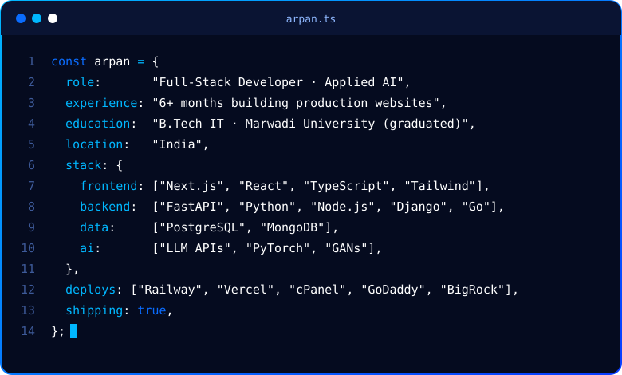

  

## ⚡ Tech Stack

 

 

 

## 🚀 Featured Projects

| Project | What it does | Stack | Links |
| :--- | :--- | :--- | :--- |
| **PeregrineQuill** | Turns any messy resume into a clean, ATS-ready DOCX/PDF **without losing a single word**. It's fully rule-based: it never adds anything and never drops anything. | Next.js 14 · FastAPI · Tailwind v4 · Docker |   |
| **Adiyogi Wellness** | Yoga and meditation tracking plus an **emotion-aware AI therapist** that detects emotion from text and voice. | React · TypeScript · Django · MongoDB · Mistral AI |  |
| **Floral Synthesis** | A DCGAN trained on Oxford 102 Flowers (8,189 images) that generates photorealistic flowers, evaluated with Inception Score and FID. | PyTorch · Python · GANs |  |
| **MailForge** | A concurrent email campaign dispatcher. It loads recipients from CSV, renders templates and sends over SMTP using producer/consumer workers. | Go · SMTP · Docker |  |
| **Bharat Sanskriti** | Celebrates India's heritage and festivals, with the **Chatur** AI chatbot, a Heritage Risk Radar and state-by-state exploration. | React · Node.js · Express · MongoDB |   |

## 🤝 Connect

